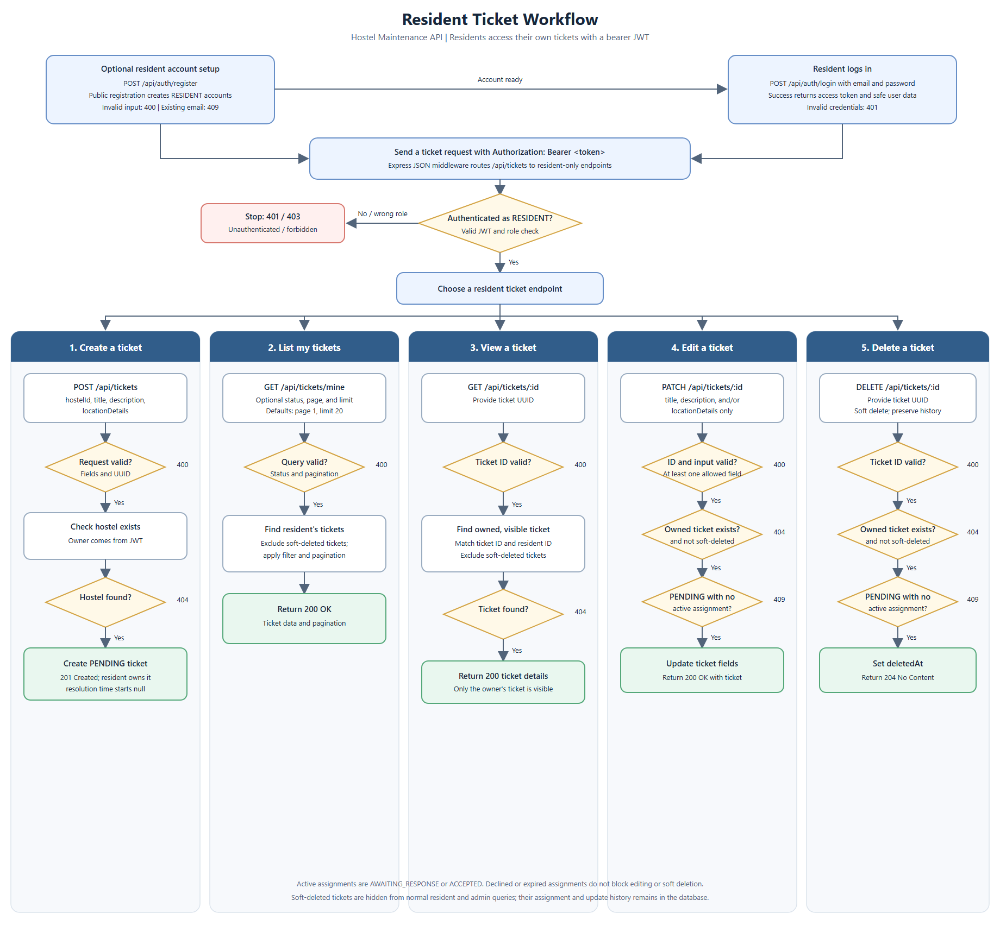
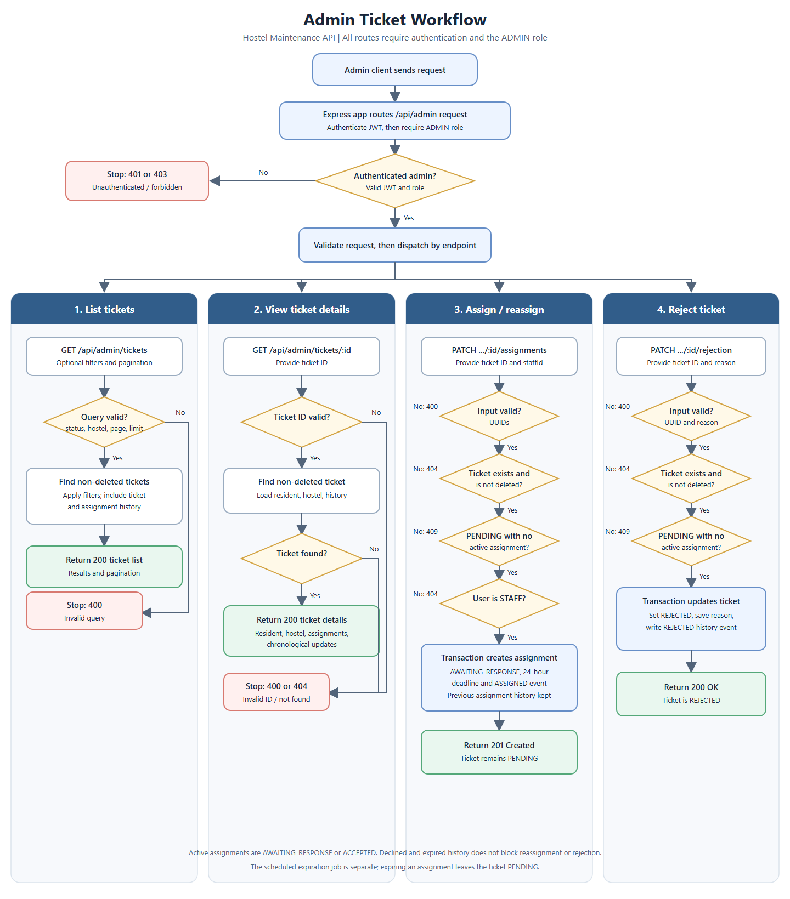
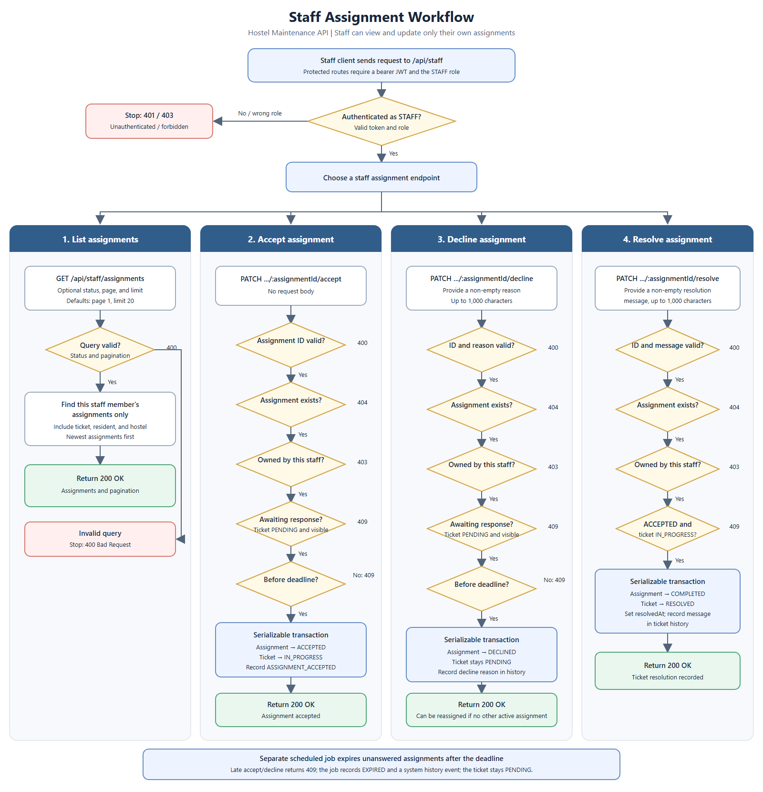

# Hostel Maintenance Tickets API

A REST API for managing maintenance reports in a hostel. Residents submit and track issues, administrators review and assign eligible tickets, and maintenance staff respond to and resolve their assignments. The service records assignment attempts and ticket events so that the workflow can be followed over time.

The API is implemented with Node.js, Express, TypeScript, PostgreSQL, and Prisma. This repository provides the API and its supporting scripts; it does not include a web or mobile client.

## Table of contents

- [Project overview](#project-overview)
- [Key features](#key-features)
- [Technology stack](#technology-stack)
- [Architecture](#architecture)
- [Roles and workflows](#roles-and-workflows)
- [Project structure](#project-structure)
- [Prerequisites](#prerequisites)
- [Local development setup](#local-development-setup)
- [Environment variables](#environment-variables)
- [Database design](#database-design)
- [API documentation](#api-documentation)
- [Authentication and authorization](#authentication-and-authorization)
- [Ticket and assignment lifecycle](#ticket-and-assignment-lifecycle)
- [Background assignment expiration](#background-assignment-expiration)
- [Validation and error handling](#validation-and-error-handling)
- [Testing](#testing)
- [Development guidelines](#development-guidelines)
- [Troubleshooting](#troubleshooting)
- [Current limitations and documented scope](#current-limitations-and-documented-scope)

## Project overview

Hostel maintenance requests are often difficult to follow when residents, administrators, and repair staff coordinate through separate channels. This API provides a shared ticket workflow: a resident reports an issue, an administrator assigns it to a staff member, and the staff member accepts, declines, or resolves the work. The database retains assignment history and important ticket events.

The implementation supports resident registration and login, resident-owned ticket operations, administrator review and assignment, and staff assignment handling. Authentication and authorization are enforced by the API rather than by client-supplied role or ownership values.

## Key features

- Resident account registration and login with hashed passwords and signed JWT access tokens.
- Ticket creation, listing, retrieval, editing, and soft deletion for the owning resident.
- Administrator ticket filtering, detail views, staff assignment/reassignment, and rejection with a reason.
- Staff assignment listing, acceptance, decline with a reason, and resolution with a message.
- A separate assignment record for every assignment attempt, preserving previous assignment history.
- Ticket event history stored with the ticket and associated user when applicable.
- Validation of request bodies, path parameters, and query parameters.
- Pagination on list endpoints.
- An hourly background job that expires unanswered assignments.
- Development scripts for creating a hostel and resident, and generating a resident token.

## Technology stack

| Technology | Purpose |
|---|---|
| Node.js | JavaScript runtime for the API and development scripts. |
| Express 5 | HTTP server, middleware, and route handling. |
| TypeScript | Typed application code, compiled to `dist/` for the production start script. |
| PostgreSQL | Relational database for users, hostels, tickets, assignments, and ticket updates. |
| Prisma 7 | Database schema, migrations, generated client, and typed database access. The project connects using Prisma's PostgreSQL driver adapter. |
| Zod | Runtime validation and parsing of request input. |
| JSON Web Token (`jsonwebtoken`) | Signed bearer-token authentication. |
| `bcrypt` | Password hashing and password verification. |
| `node-cron` | In-process hourly assignment-expiration schedule. |
| Jest, `@swc/jest`, Supertest | Unit/service and HTTP-level automated tests. |

Dependency versions and scripts are defined in [`package.json`](./package.json) and pinned by [`package-lock.json`](./package-lock.json).

## Architecture

The application separates HTTP concerns from business and persistence logic:

1. **Routes** in `src/routes/` register endpoints and attach authentication and role middleware.
2. **Middleware** validates bearer tokens, enforces roles, and forwards errors to the centralized handler.
3. **Controllers** in `src/controllers/` read validated request data, call a service, and send an HTTP response.
4. **Services** in `src/services/` enforce ownership and workflow rules and use Prisma for database operations. Related state changes and history events are grouped in database transactions where required.
5. **Prisma** uses the schema in `prisma/schema.prisma`, migrations in `prisma/migrations/`, and a generated client under `src/generated/prisma/`.

The typical request path is:

```text
HTTP request
  -> Express app and route
  -> authentication / role middleware (for protected routes)
  -> controller and request validation
  -> service (business rules and Prisma operations)
  -> PostgreSQL
  -> controller response or centralized error response
```

`src/app.ts` configures Express and mounts the API routers. `src/server.ts` loads environment configuration, starts the HTTP listener, and schedules the assignment-expiration job.

## Roles and workflows

| Role | Main capabilities | Restrictions |
|---|---|---|
| **Resident** | Register, log in, create tickets, list and view their own tickets, and edit or soft-delete eligible tickets. | Can only access their own tickets. A ticket can only be edited or deleted while `PENDING` and without an active assignment. Public registration always creates a `RESIDENT`. |
| **Admin** | View and filter visible tickets, inspect ticket and assignment history, assign/reassign eligible tickets to staff, and reject eligible tickets with a reason. | Requires an `ADMIN` account. A ticket must be pending and have no active assignment to be assigned or rejected. |
| **Staff** | View their own assignments, accept or decline an assignment, and resolve accepted work. | Requires a `STAFF` account. Can only act on their own assignment and according to its current status and response deadline. |

Admin and staff accounts cannot be created through public registration. There is no API or included setup script for creating or managing those roles; account provisioning must be handled outside this repository.

### Resident workflow

This flowchart shows resident registration and authentication, ticket reporting, status tracking, and the restrictions on changing or removing a ticket.



Editable source: [`resident-workflow.svg`](./docs/resident/resident-workflow.svg).

### Admin workflow

This flowchart shows ticket review and the administrative assignment, reassignment, and rejection paths.



Editable source: [`admin-workflow.svg`](./docs/admin/admin-workflow.svg).

### Staff workflow

This flowchart shows staff assignment responses and repair resolution. Unanswered assignments are expired separately by the scheduled job.



Editable source: [`staff-workflow.svg`](./docs/staff/staff-workflow.svg).

## Project structure

```text
.
├── docs/
│   ├── admin/                 # Admin workflow documentation and diagrams
│   ├── resident/              # Resident workflow documentation and diagrams
│   ├── staff/                 # Staff workflow documentation and diagrams
│   ├── api-spec.md            # Detailed API behavior and request/response specification
│   └── erd.drawio.png         # Database entity-relationship diagram
├── prisma/
│   ├── migrations/            # Checked-in database migrations
│   └── schema.prisma          # Database models and enums
├── src/
│   ├── controllers/           # HTTP request/response handling
│   ├── errors/                # Application error type
│   ├── jobs/                  # Scheduled assignment-expiration job
│   ├── lib/                   # Prisma client and database adapter
│   ├── middleware/            # Authentication, authorization, error handling
│   ├── routes/                # Express route registration
│   ├── scripts/               # Development-only data and token scripts
│   ├── services/              # Business rules and database operations
│   ├── types/                 # Express request type extensions
│   ├── validations/           # Zod request schemas
│   ├── app.ts                 # Express application setup and API mounts
│   └── server.ts              # Server startup and scheduled job startup
├── test/                      # Jest tests, test setup, and test TypeScript config
├── .env.example               # Environment variable template
├── jest.config.cjs            # Jest configuration
├── package.json               # Dependencies and npm scripts
├── prisma7.config.ts          # Prisma schema, migration, and datasource configuration
├── tsconfig.json              # Application TypeScript configuration
└── tsconfig.test.json         # Application and test TypeScript configuration
```

The generated Prisma client is created under `src/generated/prisma/` and is ignored by Git. Generate it after installing dependencies and configuring the database.

## Prerequisites

- Node.js and npm. The repository does not declare a specific Node.js engine version; use a Node.js release compatible with the dependencies in `package-lock.json`.
- PostgreSQL running locally or reachable through a PostgreSQL connection URL.
- Git to clone the repository.

The `psql` command-line client is useful for creating a local database, but any PostgreSQL administration tool can be used.

## Local development setup

### 1. Clone the repository and install dependencies

```git bash
git clone https://github.com/officialcoder01/Hostel-Maintenance-Ticket-API.git
cd Hostel-Maintenance-Ticket-API
npm ci
```

`npm ci` installs the locked dependency versions from `package-lock.json`.

### 2. Create a PostgreSQL database

Create a database, for example `hostel_maintenance`, using `psql` or your preferred PostgreSQL tool:

```sql
CREATE DATABASE hostel_maintenance;
```

### 3. Configure the environment

Copy the supplied template and edit `.env` with your local values:

```powershell
cp .env.example .env
```

Set `DATABASE_URL` to your PostgreSQL connection string and replace `JWT_SECRET` with a long, random local secret. A connection URL generally follows this form:

```text
postgresql://<username>:<password>@localhost:5432/hostel_maintenance?schema=public
```

URL-encode any reserved characters in the username or password. Keep `.env` private; it is excluded from Git.

### 4. Apply migrations and generate Prisma Client

With PostgreSQL running and `DATABASE_URL` configured, run:

```git bash
npx prisma migrate dev
npx prisma generate
```

The first command applies the checked-in migrations to the configured database. The second generates the Prisma client consumed by the TypeScript application.

### 5. Start the development server

```git bash
npm run dev
```

This runs the TypeScript entry point directly with the locally installed `tsx` executable. It listens on port `8080` by default, or on the port configured by `PORT`. Visit `http://localhost:8080/` (or your configured port) to receive a JSON response confirming the API is running.

### 6. Build and run the compiled server

```git bash
npm run build
npm start
```

`npm run build` compiles the application into `dist/`; `npm start` starts `dist/server.js`. Keep the server process running for the in-process assignment-expiration schedule.

### 7. Create development data and try a resident flow

The data scripts below are restricted to `NODE_ENV=development`. Start by creating a hostel:

```git bash
npm run dev:create-hostel -- "North Hall" "123 Campus Road"
```

Save the printed hostel ID. Then create a resident; the script prompts for a password interactively:

```git bash
npm run dev:create-resident -- "Alex Resident" alex@example.com
```

You can register a resident through `POST /api/auth/register` instead. Log in through `POST /api/auth/login` to get an access token, then pass it in an `Authorization: Bearer <token>` header to protected endpoints. To generate a one-hour development token for an existing resident instead of logging in:

```git bash
npm run dev:token -- alex@example.com
```

Use the saved hostel ID when creating a resident ticket. See [API documentation](#api-documentation) and [`docs/api-spec.md`](./docs/api-spec.md) for request formats and response details.

## Environment variables

| Variable | Required? | Purpose |
|---|---|---|
| `DATABASE_URL` | Yes | PostgreSQL connection URL used by Prisma. Required by Prisma configuration and the Prisma client. |
| `JWT_SECRET` | Required for authentication | Secret used to sign and verify JWTs. Login and protected-route authentication require it. Use a sufficiently long, unpredictable value; do not commit it. |
| `PORT` | No | HTTP listener port. Defaults to `8080` if missing or not numeric. |
| `NODE_ENV` | No for server startup; set to `development` for data scripts | The development data and token scripts refuse to run unless this is exactly `development`. The `npm test` script sets it to `test`. |

The current test setup assigns a test `DATABASE_URL` itself.

The server loads `.env` through `dotenv/config`. Do not put real credentials or secrets in documentation, source control, or shared logs.

## Database design

The current schema contains five main models, with UUID primary keys and PostgreSQL relations. The entity-relationship diagram is available as [`docs/erd.drawio.png`](./docs/erd.drawio.png), and the definitive model definitions are in [`prisma/schema.prisma`](./prisma/schema.prisma).

| Model | Purpose and relationships |
|---|---|
| `User` | Represents a resident, administrator, or staff member. Email is unique. A user can report tickets, receive assignments, create assignments as an administrator, and act on ticket updates. The stored password is a hash. |
| `Hostel` | Stores a hostel name and address. A hostel can have many maintenance tickets. |
| `MaintenanceTicket` | Stores the reported issue, location, status, timestamps, optional rejection reason, and soft-deletion timestamp. It belongs to one resident and one hostel and can have many assignments and updates. |
| `TicketAssignment` | Records one assignment attempt, including the staff member, assigning administrator, response deadline, status, and response time. A ticket can have multiple records so reassignment does not overwrite prior history. |
| `TicketUpdate` | Records a ticket event and optional message. Events can have a user actor or a `null` actor for system-generated events such as expiration. |

Foreign-key deletion behavior is restrictive for tickets, assignments, and their primary users/hostels, preserving related workflow records. Deleting a resident ticket through the API sets `deletedAt` rather than physically deleting the record; normal resident and admin ticket lists exclude soft-deleted tickets.

## API documentation

The API base path is `/api`. Requests and responses use JSON, IDs are UUIDs, and timestamps are ISO 8601. List endpoints use `page` and `limit` query parameters, defaulting to page `1` and limit `20`; the maximum limit is `100`.

The detailed request bodies, validations, response shapes, status codes, and business rules are documented in [`docs/api-spec.md`](./docs/api-spec.md). The following grouped summary lists routes currently registered in `src/routes/`.

### Authentication

| Method | Path | Access | Purpose |
|---|---|---|---|
| `POST` | `/api/auth/register` | Public | Register a resident account. |
| `POST` | `/api/auth/login` | Public | Authenticate and return a JWT and public user profile. |
| `GET` | `/api/auth/me` | Any authenticated role | Return the authenticated user's public profile. |

### Resident

| Method | Path | Access | Purpose |
|---|---|---|---|
| `POST` | `/api/tickets` | Resident | Create a ticket. |
| `GET` | `/api/tickets/mine` | Resident | List the authenticated resident's tickets. |
| `GET` | `/api/tickets/:id` | Owning resident | Get one of the resident's tickets. |
| `PATCH` | `/api/tickets/:id` | Owning resident | Edit permitted fields on an eligible ticket. |
| `DELETE` | `/api/tickets/:id` | Owning resident | Soft-delete an eligible ticket; responds with no content. |

### Admin

| Method | Path | Access | Purpose |
|---|---|---|---|
| `GET` | `/api/admin/tickets` | Admin | List, filter, and paginate visible tickets. |
| `GET` | `/api/admin/tickets/:id` | Admin | Get ticket details, assignment history, and updates. |
| `PATCH` | `/api/admin/tickets/:id/assignments` | Admin | Assign or reassign a ticket to a staff member. |
| `PATCH` | `/api/admin/tickets/:id/rejection` | Admin | Reject an eligible ticket with a reason. |

### Staff

| Method | Path | Access | Purpose |
|---|---|---|---|
| `GET` | `/api/staff/assignments` | Staff | List the authenticated staff member's assignments. |
| `PATCH` | `/api/staff/assignments/:assignmentId/accept` | Owning staff member | Accept an awaiting assignment. |
| `PATCH` | `/api/staff/assignments/:assignmentId/decline` | Owning staff member | Decline an awaiting assignment with a reason. |
| `PATCH` | `/api/staff/assignments/:assignmentId/resolve` | Owning staff member | Resolve an accepted assignment with a message. |

## Authentication and authorization

- Public registration creates only `RESIDENT` users; clients cannot choose a role.
- Login checks the submitted password against the stored bcrypt hash and returns a JWT that expires after one hour.
- Protected requests must send `Authorization: Bearer <token>`.
- The authentication middleware verifies the token and reads the user ID (`sub`) and role claims. Routes then require the appropriate `RESIDENT`, `ADMIN`, or `STAFF` role.
- Services enforce resource ownership and allowed state transitions in addition to route-level role checks.
- Admin and staff provisioning is outside this repository; there are no public account-management endpoints or admin/staff bootstrap scripts.

## Ticket and assignment lifecycle

Ticket status and assignment status are separate state machines. A ticket can accumulate multiple assignment records while its ticket status remains pending after a decline or expiration.

### Ticket statuses

| Status | Meaning |
|---|---|
| `PENDING` | Reported and eligible for review or assignment when there is no active assignment. |
| `IN_PROGRESS` | An assigned staff member accepted the work. |
| `RESOLVED` | The accepted assignment was completed and the ticket was resolved. |
| `REJECTED` | An administrator rejected the report with a reason. |

### Assignment statuses

| Status | Meaning |
|---|---|
| `AWAITING_RESPONSE` | A staff member has been assigned and has not responded. |
| `ACCEPTED` | The assigned staff member accepted; the ticket moves to `IN_PROGRESS`. |
| `DECLINED` | The assigned staff member declined; the ticket remains `PENDING` and may be reassigned. |
| `EXPIRED` | The response deadline passed without a response; the ticket remains `PENDING`. |
| `COMPLETED` | The accepted assignment was resolved; the ticket moves to `RESOLVED`. |

Important rules enforced by the services:

- Admin assignment and rejection require a visible `PENDING` ticket with no assignment in `AWAITING_RESPONSE` or `ACCEPTED`.
- Each assignment sets a response deadline 24 hours after it is created. Reassignment creates a new record instead of overwriting history.
- Staff can accept or decline only their own assignment while it is awaiting a response, before its deadline, and while its ticket is pending.
- Only the staff member who owns an accepted assignment can resolve it. Resolution completes the assignment, resolves the ticket, sets `resolvedAt`, and records a history event.
- Residents can edit or soft-delete only their own pending tickets with no active assignment. Declined or expired assignment records alone do not prevent those actions.
- Administrative rejection requires a reason and is recorded as a ticket update.
- Important transitions are recorded in `TicketUpdate`; multi-record changes use database transactions.

## Background assignment expiration

When the server starts, it schedules `runAssignmentExpirationJob` with `node-cron` to run at the start of every hour. Each run processes at most 100 assignments whose status is `AWAITING_RESPONSE` and whose deadline has passed. Each expiration and its system-authored ticket update are committed together; the assignment becomes `EXPIRED` and the ticket stays `PENDING`.

Expiration is performed by the running API process, not by a separate endpoint. Keep a server process running for automatic expiration. Because this is an in-process schedule, environments that suspend or frequently restart application processes need an external scheduler or another reliable job runner.

## Validation and error handling

Request bodies, route parameters, and query parameters are parsed with Zod schemas. Schemas reject unrecognized fields where defined; string lengths, UUIDs, status filters, and pagination bounds are validated before service operations.

Errors use a consistent JSON envelope:

```json
{
  "error": {
    "code": "RESOURCE_NOT_FOUND",
    "message": "Ticket not found."
  }
}
```

Validation errors return `400` and can include field-level issue details. Application errors return their defined status, code, and message. Unexpected errors are logged by the server and return a generic `500` response without exposing internal details.

| HTTP status | Typical use |
|---|---|
| `200 OK` | Successful read or update. |
| `201 Created` | Resource created, including resident registration and ticket creation. |
| `204 No Content` | Successful soft deletion. |
| `400 Bad Request` | Invalid input or validation failure. |
| `401 Unauthorized` | Missing/invalid token or invalid credentials. |
| `403 Forbidden` | Authenticated user lacks the required role or permission. |
| `404 Not Found` | Resource does not exist or is inaccessible to the caller. |
| `409 Conflict` | Requested operation is incompatible with the resource's current state. |
| `500 Internal Server Error` | Unexpected server-side failure. |

## Testing

Tests are in `test/` and use Jest with `@swc/jest` to execute TypeScript and Supertest for HTTP-level checks. `test/setup.cjs` initializes environment values, while service dependencies can be injected to test business rules without relying on production data.

The suite covers:

- Authentication service behavior, registration/login validation, and auth HTTP routes.
- Ticket validation, ticket service rules, and resident ticket HTTP routes.
- Admin ticket service behavior and admin HTTP routes.
- Staff assignment service behavior and staff HTTP routes.
- Assignment expiration service behavior and scheduled-job behavior.

Run the automated tests and static checks:

```git bash
npm test
npm run typecheck
npm run test:typecheck
```

`npm test` runs Jest serially with `NODE_ENV=test`. `npm run typecheck` checks the application source without emitting files. `npm run test:typecheck` type-checks both application and test code.

## Development guidelines

- Read [`docs/api-spec.md`](./docs/api-spec.md) and [`prisma/schema.prisma`](./prisma/schema.prisma) before changing endpoint behavior or data relationships.
- Keep HTTP registration in routes, HTTP handling in controllers, and business/database logic in services.
- Validate all client input at runtime; TypeScript types do not validate incoming JSON.
- Enforce role, ownership, and workflow-state rules on the server.
- Use Prisma and existing transactions for related state changes and history records.
- Keep secrets in local environment configuration, not source files.
- Add or update focused tests when changing validation, authorization, service rules, or endpoints.
- Update this README or the detailed API/workflow documentation when externally visible behavior changes.

## Troubleshooting

| Problem | Checks and resolution |
|---|---|
| Prisma reports that `DATABASE_URL` is missing | Confirm `.env` is in the repository root and contains a valid `DATABASE_URL`. Prisma configuration and the application load environment values from that file. |
| PostgreSQL connection is refused | Confirm the database service is running, the host and port in `DATABASE_URL` are reachable, and the database exists. |
| Connection fails after adding special characters to a password | URL-encode reserved characters in the username or password portion of `DATABASE_URL`. |
| Prisma says a table or column does not exist | Check the target database, then apply the checked-in migrations with `npx prisma migrate dev`. Generate the client with `npx prisma generate` after setup or schema changes. |
| TypeScript cannot find the generated Prisma client | Run `npx prisma generate` after installing dependencies and configuring `DATABASE_URL`. |
| Login or protected requests report JWT configuration errors | Set `JWT_SECRET` in `.env`, restart the server, and obtain a new token. Tokens expire after one hour. |
| A development data script refuses to run | Set `NODE_ENV=development` in the local `.env`; these scripts deliberately do not run in other environments. |
| A request returns `409 Conflict` | The requested action may be disallowed by the ticket or assignment's current status, active assignment, or response deadline. Check the lifecycle rules and API specification. |
| Development server does not use the expected port | Set `PORT` in `.env`; the default is `8080`. Restart the server after changing environment values. |

## Current limitations and documented scope

- Public endpoints do not manage hostels, and the repository does not provide production workflows or scripts for provisioning admin and staff users. The development hostel script is for local setup only.
- Assignment expiration relies on an in-process hourly schedule; it is not suitable for environments where the application process is not kept alive unless a reliable external scheduler is added.
- The API specification lists real-time chat, notifications, media uploads, automatic staff selection, and analytics as out of scope for version 1. They are not implemented features.
