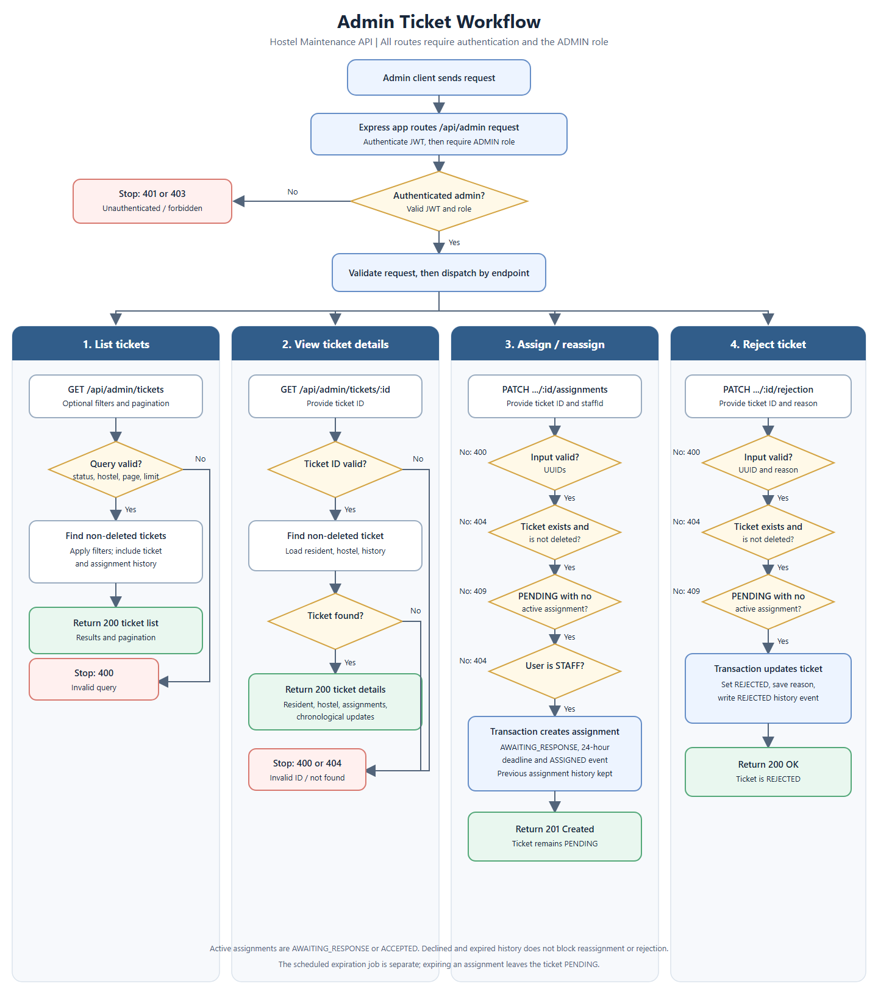

# Admin Workflow Flowchart

Editable vector source: [admin-workflow.svg](./admin-workflow.svg).

The scheduled job that expires unanswered assignments runs separately from
these admin endpoints. Expiration leaves the ticket `PENDING`.
