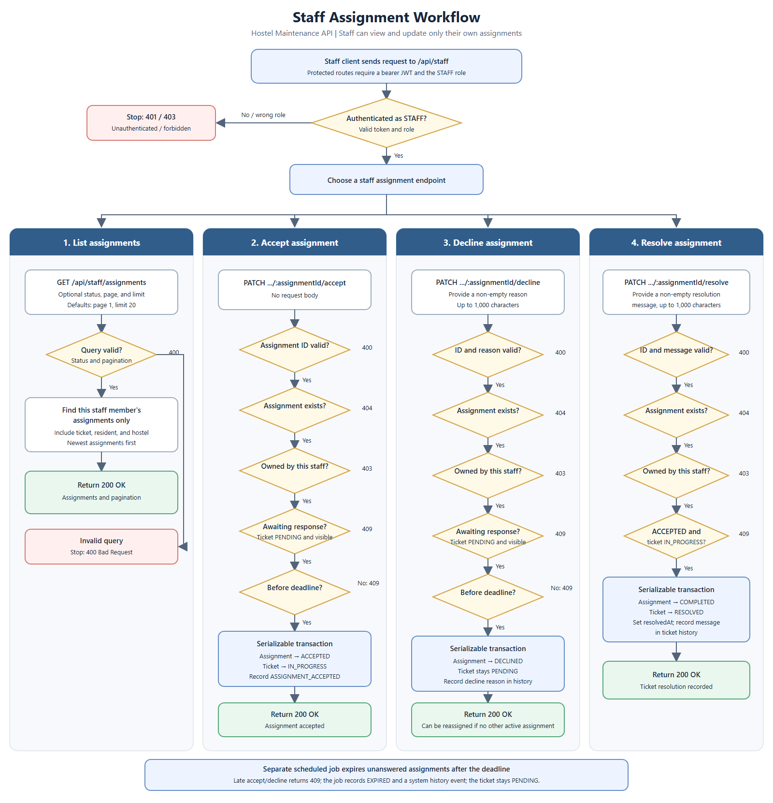

# Staff Workflow Flowchart

Editable vector source: [staff-workflow.svg](./staff-workflow.svg).

Unanswered assignments are expired separately by the scheduled expiration job.
It marks the assignment `EXPIRED`, records a system-authored history event, and
leaves the ticket `PENDING`.
